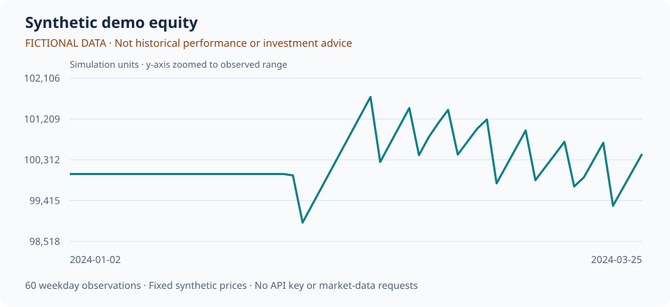

# Stock Daily Analyzer

[中文](README.md) | [English](README.en.md)

[](https://github.com/oliverran/stock-daily-analyzer/actions/workflows/ci.yml)

**A Python toolkit for Chinese A-share screening, daily research reports, and portfolio backtesting.** Optional LLM analysis adds news context and explanations of candidate stocks.

Start with the offline demo: fixed synthetic prices, no API key, and no market-data or model requests. Installation downloads dependencies; the demo itself runs offline.

[View the demo without installing](docs/demo/README.en.md) · [Quick start](#quick-start) · [Demo outputs](#what-the-demo-produces) · [Real-data workflows](#real-data-workflows) · [Development](#development-and-feedback)

> For learning and research only, not investment advice. Synthetic demo results do not represent historical market performance or expected returns. The project does not place orders.

## See the output first

[](docs/demo/README.en.md)

**[Open the English demo summary on GitHub →](docs/demo/README.en.md)** Inspect the simulated metrics, portfolio weights, and downloadable data without Python or an API key. The preview is generated by the actual demo, not manually entered performance numbers.

For the full visual report, clone or download the repository and open `docs/demo/report.html` in your browser. Keep the entire `docs/demo/` directory together so its CSV and JSON links work. The report has no scripts, external fonts, or CDN dependencies. GitHub shows HTML source rather than running the report.

## What you can do

- **Screen A-shares daily:** apply volume-breakout, trend, and oversold-rebound rules, write a text report, and save history in SQLite.
- **Add optional LLM commentary:** use Volcengine Ark or a compatible endpoint for news, fundamentals, and historical-move context. You provide credentials and pay any provider charges.
- **Review recorded candidates:** inspect past recommendations separately from the portfolio-backtesting workflow.
- **Study the `qf` research pipeline:** calculate factors, score stocks, form a TopK equal-weight portfolio, rebalance weekly, and export equity, holdings, and metrics.
- **Run locally or deploy:** use the CLI and supplied deployment examples. System notifications use macOS; other platforms log notifications instead.

The live workflows focus on Chinese A-shares. Translating this guide does not change the market universe or localize all report text and logs.

## Try it in your browser

[**Open the runnable notebook in Google Colab →**](https://colab.research.google.com/github/oliverran/stock-daily-analyzer/blob/main/notebooks/offline_demo.ipynb)

Run the actual synthetic backtest, inspect weights, compare TopK settings, and download the results without installing Python locally. Review the cells and choose **Runtime → Run all** using a standard CPU runtime. Google sign-in and an available runtime may be required; the first cell downloads the pinned project revision and dependencies. No API key, paid runtime, or Drive mount is needed. The notebook includes Chinese and English instructions.

The project revision is fixed for this tutorial; dependency versions are resolved during installation. All prices are fictional, and the comparison is not evidence of a profitable strategy. [View the notebook source](notebooks/offline_demo.ipynb) before running it. If Colab is unavailable, use the local instructions below or the [installation-free preview](docs/demo/README.en.md).

## Quick start

You need Git and **Python 3.9 or newer**. The first installation requires internet access.

### macOS / Linux

```bash
git clone https://github.com/oliverran/stock-daily-analyzer.git
cd stock-daily-analyzer
python3 -m venv .venv
source .venv/bin/activate
python -m pip install -e .
stock-analyzer demo
```

### Windows PowerShell

Use the virtual environment's executables directly; changing your PowerShell execution policy is not necessary:

```powershell
git clone https://github.com/oliverran/stock-daily-analyzer.git
cd stock-daily-analyzer
python -m venv .venv
.\.venv\Scripts\python.exe -m pip install -e .
.\.venv\Scripts\stock-analyzer.exe demo
```

Do not copy `.env` or configure an LLM for this demo. Expected output:

```text
Synthetic data only. Not historical market data or investment advice.
Offline demo complete: 3 fictional symbols, 60 weekday observations.
reports/demo/equity.csv
reports/demo/holdings.csv
reports/demo/summary.json
reports/demo/equity.svg
reports/demo/report.html
Open report.html in your browser to view the synthetic results.
```

Windows paths may use `\` instead of `/`. For the commands below, activate your environment first or keep using `.\.venv\Scripts\stock-analyzer.exe` on Windows.

## What the demo produces

The demo calls the existing `DailyBacktester` with 60 weekday observations for three fictional symbols: `DEMO_A`, `DEMO_B`, and `DEMO_C`. Prices follow fixed formulas. It does not fetch market data or news, call an LLM, or write to the daily-report database.

- `report.html`: a self-contained visual report with parameters and a full equity table.
- `equity.svg`: an embeddable equity chart labeled as synthetic data.
- `equity.csv`: simulated portfolio equity by date.
- `holdings.csv`: daily portfolio weights; `__CASH__` means cash. The demo stays in cash until enough factor history is available.
- `summary.json`: synthetic-data provenance, parameters, total return, annualized return, Sharpe ratio, and maximum drawdown.

Open `reports/demo/report.html` in a browser, or inspect the CSV files in a spreadsheet. To use another output directory:

```bash
stock-analyzer demo --out reports/my-demo
```

Repeating a run overwrites the demo files with the same names in the selected directory. Weekdays are not an exchange trading calendar. Prices, costs, and trading constraints are examples; the metrics illustrate the output format, not a strategy's real-world performance.

## Real-data workflows

Try these after the offline demo works. Both workflows depend on external services and may encounter timeouts, rate limits, or missing data.

```bash
stock-analyzer self-check
stock-analyzer --help
```

`self-check` checks module imports only. **It does not validate credentials, data availability, or a complete analysis run.**

### 1. Daily screening and reports

```bash
stock-analyzer run-daily
```

Market data comes from AkShare / yfinance. Without LLM credentials, the app skips LLM analysis and can still run quantitative screening. Outputs include:

- `reports/report_YYYY-MM-DD.txt`: the daily report.
- `stock_analysis.db`: local history.
- `logs/`: execution logs.

These paths are under the source directory. Review the rules in [`config.py`](config.py) and [`strategies.py`](strategies.py). A first run has no previous recommendations to evaluate; full-market scan time depends on the data services.

**Optional LLM setup:** copy [`.env.example`](.env.example) to `.env` and replace the placeholders with your own provider credentials:

```ini
ARK_API_KEY=your_api_key_here
ARK_MODEL_ID=your_model_endpoint_id
ARK_BASE_URL=https://ark.cn-beijing.volces.com/api/v3/chat/completions
LLM_DEBUG=0
```

Use a model or inference endpoint ID available to your account. `ARK_BASE_URL` is the complete chat-completions URL. Unchanged placeholder values will cause invalid LLM requests; leave these variables unset if you do not need LLM analysis. Check compatibility yourself before using another provider.

`.env` is ignored by Git. Never paste API keys into issues, logs you share, or commits. Model calls may incur provider charges.

### 2. Portfolio backtesting

Review the dates and universe in [`experiments/default_a_share_daily.json`](experiments/default_a_share_daily.json), then run:

```bash
stock-analyzer backtest --config experiments/default_a_share_daily.json
```

The original script entry point is also available:

```bash
python run_experiment.py --config experiments/default_a_share_daily.json
```

Outputs go to `reports/experiments/<experiment_name>/`: `equity.csv`, `holdings.csv`, and `summary.json`.

- `universe`: symbol prefixes, ST filtering, and stock-count limit.
- `data`: provider, cache location, and request timeout.
- `factors`: lookback windows and factor weights.
- `portfolio`: TopK size and maximum per-stock weight.
- `trading`: simplified suspension, price-limit, T+1, and stamp-duty assumptions.
- `backtest`: dates, rebalance frequency, commission, slippage, and initial cash.

**Research limits:** online experiments use the universe fetched at run time, not a historical point-in-time universe, which can introduce survivorship bias. Trading constraints and costs are simplified. Check completeness, price adjustments, execution assumptions, and applicable market rules before interpreting results. The offline demo does not validate any live-data or LLM service.

## Troubleshooting

- **`stock-analyzer` is not found:** run `python -m pip install -e .` in the repository with the intended environment. You can also use `python -m qf.cli demo`.
- **`IMPORT_OK`, but a live run fails:** import checks do not test external access. Inspect `logs/` and the data-source responses. Use `stock-analyzer demo` to separate local installation problems from service failures.
- **No candidates or history:** rules may not match, data may be missing, or no earlier runs may exist. An empty result does not establish that every data source worked.
- **No desktop notification:** non-macOS platforms log the notification instead.

## Development and feedback

In an activated virtual environment:

```bash
python -m pip install -e ".[dev]"
ruff check .
pytest -q
```

After changing the demo, run `python scripts/update_demo_preview.py` to regenerate the committed preview and both language summaries. Tests check that the committed preview matches the current code. Tests and demo generation do not require real market requests or API keys.

CI runs lint and tests on Python 3.9, 3.10, 3.11, and 3.12 on Linux. The Python 3.12 job also checks the offline report in Chromium. This is not verification of live services, Windows/macOS behavior, or every browser.

Keep contributions small and include tests for new behavior. Report problems in [Issues](https://github.com/oliverran/stock-daily-analyzer/issues) with your operating system, Python version, exact command, and a sanitized error. More details: [contributing guide](CONTRIBUTING.md) (Chinese), [security policy](SECURITY.md), and [changelog](CHANGELOG.md).

If the project helps your research, a Star or a reproducible bug report is welcome. Do not share synthetic demo metrics as real market performance.

## Deployment and source map

Validate your chosen live workflow locally before scheduling it. The [quick deployment guide](QUICK_DEPLOY.md) and [deployment documentation](DEPLOYMENT.md) are in Chinese; [`deploy/`](deploy/) contains systemd, Supervisor, Docker, and scheduling examples.

- [`qf/`](qf/): factors, scoring, portfolio construction, backtesting, demo, and CLI.
- [`experiments/`](experiments/): online experiment configuration.
- [`tests/`](tests/): unit tests and offline smoke tests.
- [`analyzer.py`](analyzer.py): daily quantitative screening.
- [`llm.py`](llm.py) and [`attribution.py`](attribution.py): optional LLM commentary and historical-move context.
- [`backtester.py`](backtester.py): review of recorded recommendations.
- [`reporting.py`](reporting.py) and [`config.py`](config.py): daily reports and configuration.

## License

[MIT](LICENSE). For learning and research only, not investment advice.
