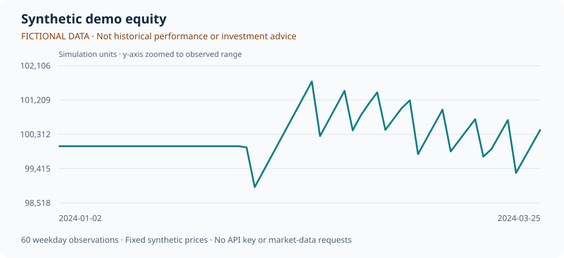

# Synthetic demo: inspect the results before installing

[中文](README.md) | [English](README.en.md)

**These are simulated results from fictional prices, not historical market performance or investment advice.**

Read this page directly on GitHub without Python, an API key, or a download. The chart, metrics, and holdings come from the same `stock-analyzer demo` run using the project's `DailyBacktester`, not manually entered display numbers.



## What this demo ran

- Dates: 2024-01-02 to 2024-03-25, with 60 weekday observations.
- Fictional symbols: `DEMO_A`, `DEMO_B`, `DEMO_C`.
- Simulated initial cash: 100,000.00; final equity: 100,440.92.
- 20-day momentum factor, Top 2 equal-weight portfolio, rebalance frequency `W-FRI`. The portfolio stays in cash until enough factor history is available.
- Weekdays are not an exchange trading calendar. Commission, slippage, and trading constraints are example settings.

## Simulated metrics: output-format examples only

| Metric | This synthetic demo |
| --- | ---: |
| Simulated total return | 0.44% |
| Simulated maximum drawdown | -2.35% |
| Simulated annualized return | 1.86% |
| Simulated Sharpe ratio | 0.27 |

Annualized values and Sharpe ratios from a short synthetic sample do not represent achievable returns. See [summary.json](summary.json) for full precision and parameters.

## Portfolio weights on the final day

2024-03-25; `__CASH__` means cash.

| Symbol | Weight |
| --- | ---: |
| `__CASH__` | 0.00% |
| `DEMO_A` | 50.00% |
| `DEMO_B` | 50.00% |
| `DEMO_C` | 0.00% |

## Inspect the data and full report

- [Equity CSV](equity.csv): daily simulated equity, including all 60 observations used in the chart.
- [Holdings CSV](holdings.csv): daily portfolio weights.
- [Parameters and metrics JSON](summary.json): synthetic-data provenance, settings, and metrics.
- [Full report HTML source](report.html): GitHub shows source. Save all files in this directory locally, then open `report.html` in a browser to inspect the expandable parameters and full equity table.

## Reproduce it yourself

Follow the [quick start](../../README.en.md#quick-start), then run:

```bash
stock-analyzer demo
```

Open the generated `reports/demo/report.html`. The demo makes no market-data, news, or LLM requests; installing dependencies initially requires internet access. After changing the demo source, run `python scripts/update_demo_preview.py` to regenerate both language summaries and the data files.

[Back to the project and real-data setup](../../README.en.md) · [Report a problem](https://github.com/oliverran/stock-daily-analyzer/issues)

If the output is useful for your research, a Star on the [repository](https://github.com/oliverran/stock-daily-analyzer) is welcome. Do not present synthetic demo metrics as real market performance.
