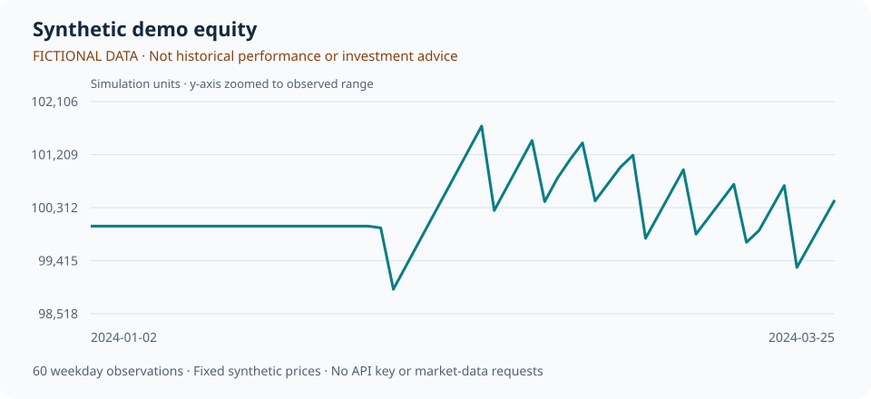

# 合成数据演示：先看结果，再决定是否安装

[中文](README.md) | [English](README.en.md)

**这是虚构价格的模拟输出，不是真实市场业绩，不构成投资建议。**

本页可直接在 GitHub 阅读，无需 Python、API Key 或下载。图表、指标和持仓来自同一次 `stock-analyzer demo` 执行，使用项目的 `DailyBacktester`，不是手写展示数字。



## 这次演示运行了什么

- 日期：2024-01-02 至 2024-03-25，共 60 条工作日观察。
- 虚构标的：`DEMO_A`, `DEMO_B`, `DEMO_C`。
- 模拟初始资金：100,000.00；期末净值：100,440.92。
- 20 日动量因子，Top 2 等权组合，调仓频率 `W-FRI`；因子历史不足时保持现金。
- 普通工作日并非交易所日历。佣金、滑点和交易约束均为示例设置。

## 模拟指标，仅用于理解输出格式

| 指标 | 本次合成演示 |
| --- | ---: |
| 模拟累计收益 | 0.44% |
| 模拟最大回撤 | -2.35% |
| 模拟年化收益 | 1.86% |
| 模拟 Sharpe | 0.27 |

短期合成样本的年化值和 Sharpe 不代表可实现收益。完整精度与参数见 [summary.json](summary.json)。

## 最后一天的组合权重

2024-03-25；`__CASH__` 表示现金。

| 标的 | 权重 |
| --- | ---: |
| `__CASH__` | 0.00% |
| `DEMO_A` | 50.00% |
| `DEMO_B` | 50.00% |
| `DEMO_C` | 0.00% |

## 查看数据与完整报告

- [净值 CSV](equity.csv)：逐日模拟净值，图表的全部 60 个观察值来自这里。
- [持仓 CSV](holdings.csv)：每日组合权重。
- [参数与指标 JSON](summary.json)：明确标注合成数据来源，记录模拟设置和指标。
- [完整报告 HTML 源文件](report.html)：GitHub 显示源码。将本目录全部文件保存到本地，再用浏览器打开 `report.html`，可查看可折叠参数与完整净值表。

## 自己复现

按[快速开始](../../README.md#快速开始)安装后运行：

```bash
stock-analyzer demo
```

打开生成的 `reports/demo/report.html`。演示运行不访问行情、新闻或 LLM 服务；首次安装依赖需要联网。若从源码修改演示，运行 `python scripts/update_demo_preview.py` 可同步本页与数据文件。

[返回项目与真实数据接入说明](../../README.md) · [反馈问题](https://github.com/oliverran/stock-daily-analyzer/issues)

如果输出形式对你的研究有帮助，欢迎在[项目主页](https://github.com/oliverran/stock-daily-analyzer)点 Star。请勿将合成演示指标当作真实业绩传播。
